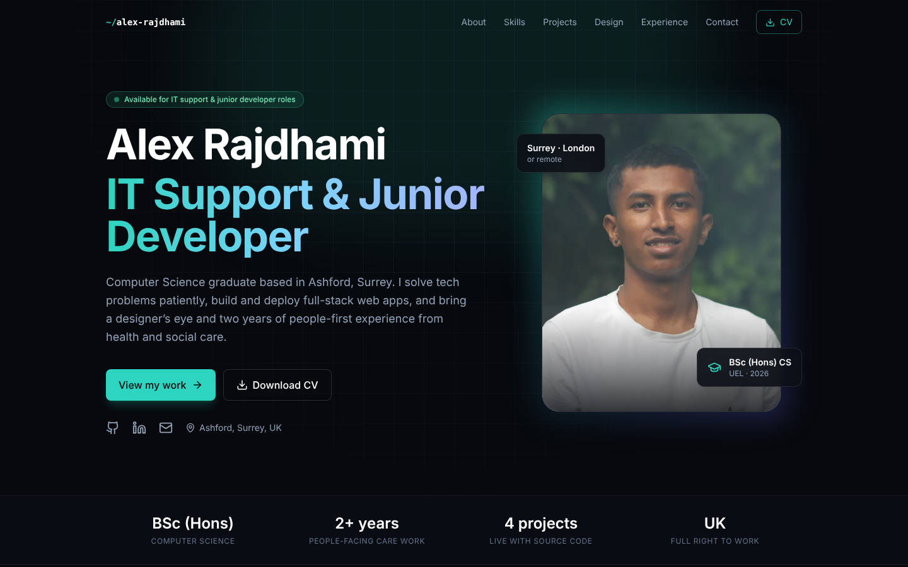

# Alex Rajdhami – Portfolio

My personal portfolio website: IT support and junior developer, BSc (Hons) Computer Science graduate (University of East London, 2026), based in Ashford, Surrey.



## What's on it

- **About:** my background, and how my two years in health and social care carry over to IT support
- **Skills:** IT support, security, development, tools and delivery
- **Projects:** four finished projects, each with a live demo and source code
  - [AI Career Recommender](https://github.com/AlexRajdhami/ai-career-recommender)
  - [Freelance Escrow DApp](https://github.com/AlexRajdhami/freelance-escrow-dapp)
  - [Lumière Studio](https://github.com/AlexRajdhami/photography-portfolio)
  - [Synth](https://github.com/AlexRajdhami/Synth)
- **Design:** a filterable gallery of my graphic and UI design work, with a keyboard-friendly lightbox
- **Experience, education and certifications**
- **CV download (PDF)** and a contact form that opens your email app

## Tech stack

React 18 · TypeScript · Tailwind CSS · Framer Motion · Vite · Vitest · deployed on Vercel

It's accessible (skip link, keyboard focus styles, reduced-motion support), responsive from 360 px up, and the tests check that every project has working links, the CV can be downloaded and no phone number is published. The design gallery filter, lightbox and contact form validation are tested too.

## Run it locally

```bash
npm install
npm run dev      # http://localhost:5173
npm test
npm run build
```

## Deploy

Import the repository into [Vercel](https://vercel.com/new). It detects Vite automatically (build command `npm run build`, output folder `dist`).

## Contact

[LinkedIn](https://linkedin.com/in/alexrajdhami) · [GitHub](https://github.com/AlexRajdhami) · alexrajdhami611@gmail.com

Licence: MIT
